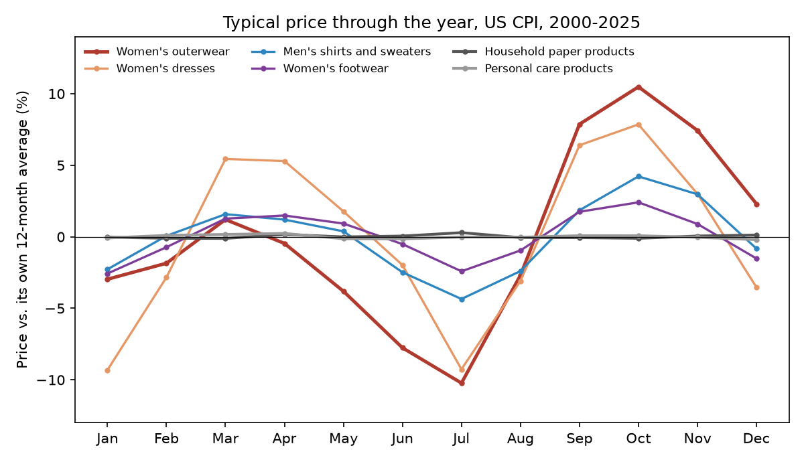
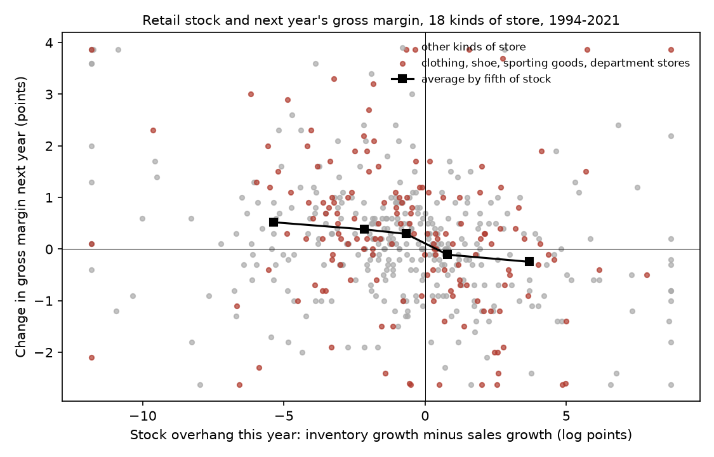

# The Coat Is Cheaper in January

### In 2016, Simon Board and Andrzej Skrzypacz worked out how a store should price a fixed stock of goods before a deadline when shoppers can wait. I checked their predictions against 26 years of US prices and three decades of retailers' books.

---

A women's winter coat is at its most expensive in October. Across the Bureau of Labor Statistics price
index for women's outerwear, the typical October price from 2000 to 2025 sat 10.5% above the coat's own
average for the year. By January it was 3.0% below, and by July, when nobody wants one, 10.2% below. A
coat that cost $200 in October cost about $175 in January. Shoppers know this, and stores plan for it.
Nordstrom advertises a half-yearly sale, and department stores such as Macy's and Kohl's mark down their
winter stock every January.

The puzzle is why a store would teach its customers to wait. Every shopper who holds off until January
pays less than she would have paid in October, and a store could in principle refuse to discount at all.
The economics of that choice, a seller with a fixed stock, a deadline, and buyers who can time their
purchases, is hard. Two economists, one at UCLA and one at Stanford, worked out the best possible
selling plan for it in a 2016 paper.

---

## Cutoffs, and the price that keeps them

Board and Skrzypacz start from the idea that runs through modern auction theory. A seller cares less
about a buyer's value than about his marginal revenue, the value minus the discount she has to give
everyone above him in order to sell to him. Writing $`v`$ for a shopper's value, $`F(v)`$ for the share
of shoppers valued below $`v`$ and $`f(v)`$ for how thickly they cluster at $`v`$,

```math
m(v) = v - \frac{1 - F(v)}{f(v)}
```

If values run evenly from 0 to 1 (think of a fraction of the full price), then $`F(v) = v`$ and
$`f(v) = 1`$, and a shopper who values the coat at 0.75 brings marginal revenue of 0.50.

```math
m(v) = v - \frac{1 - v}{1} = 2v - 1, \qquad m(0.75) = 2 \times 0.75 - 1 = 0.50
```

Selling to anyone below 0.5 loses money on the margin, which is why 0.5 is the ordinary one-shot monopoly
price for these shoppers.

The paper's first result is that the best possible selling plan, among every scheme a store could
design, sells a unit to the highest-value shopper in the market whenever that shopper clears a cutoff.
The cutoff depends only on how many units are left and how much time remains, and it is lower when more
units are left. With one unit, shoppers arriving at a steady rate $`\lambda`$ and an interest rate $`r`$
that measures how fast the good loses its value, the cutoff $`x^*`$ before the deadline solves the
paper's equation (7), where $`\mathbb{E}`$ averages over the value of the next shopper to arrive.

```math
r\, m(x^*) = \lambda\, \mathbb{E}\big[\max\{m(v) - m(x^*),\ 0\}\big]
```

The left side is what the store loses by waiting a moment, the right side what it gains from the
chance that a new shopper arrives with higher marginal revenue. In the paper's illustration ten interested shoppers arrive over a season, values are spread evenly from 0 to 1, and the
good loses a quarter of its value over the season, so $`r = \ln(4/3) = 0.288`$.

```math
0.288\,(2x^* - 1) = 10\,(1 - x^*)^2 \quad\Longrightarrow\quad x^* = 0.857
```

Until the last moment the store sells only to someone who values the good at 0.857 or more, and at the
deadline it drops the cutoff to the monopoly level of 0.5 and sells to the best shopper still waiting.

| Interested shoppers per season | Cutoff before the deadline | Cutoff at the deadline |
|---|---|---|
| 1 | 0.679 | 0.500 |
| 10 | 0.857 | 0.500 |
| 50 | 0.930 | 0.500 |

The more shoppers a store expects, the longer it holds out for a high one. Prices follow from the
cutoffs. A shopper at the cutoff must be indifferent between buying at today's price $`p_t`$ and waiting,
and waiting costs him a day of wearing the coat and the risk that a new arrival valued above him takes
it. The paper's equation (9) gives the price path that keeps him indifferent.

```math
\frac{dp_t}{dt} = -\,r\,x^* - \big(x^* - p_t\big)\,\lambda\,\big[1 - F(x^*)\big] \;<\; 0
```

Both terms are negative, so the posted price falls over the season even while the cutoff stays flat. The
paper's conclusion says that if shoppers arrive evenly over time, then for a fixed stock prices should be
"decreasing and concave," falling faster as the deadline approaches. And because the cutoff falls with
inventory, a store holding more stock should cut sooner and deeper.

---

## Two theorists and a coat

Simon Board is a professor of economics at UCLA, where he holds the Benjamin Graham Centennial Chair,
and he took his doctorate at Stanford's Graduate School of Business. Andrzej Skrzypacz is the Theodore J.
Kreps Professor of Economics at Stanford's business school. He earned his PhD at the University of
Rochester in 2000, was a co-editor of the *American Economic Review* from 2011 to 2014, and was elected a
Fellow of the Econometric Society in 2012.

Their paper, "Revenue Management with Forward-Looking Buyers," appeared in the *Journal of Political
Economy* in 2016, and it opens with a coat. Retailers stock up in autumn, run a sequence of sales in
January, and give away what is left, and around 60 percent of consumers, by the surveys the authors cite,
wait for a sale. Earlier revenue-management models assumed that a buyer who does not buy at once
disappears. Board and Skrzypacz let him stay, which means the store's January price
reaches back and changes who buys in November. They showed that the best plan is still simple. It needs
only a schedule of posted prices with a final auction, in practice a final clearance, and the store gains
nothing by hiding how much stock it has. They also proved that a store does better when shoppers stay in the
market than when each one buys at once or leaves, because shoppers who stay let it pool arrivals from
different times and sell to the best of them.

The single-unit cutoff shows how the argument works. Divide the season into short periods of length
$`h`$. In each one a new shopper arrives with probability $`\lambda h`$, a sale delayed by one period is
worth $`e^{-rh}`$ as much, and at the cutoff the store is indifferent between selling now and waiting one
period, which the paper shows is enough. Waiting yields the better of the current shopper and the
newcomer.

```math
\begin{aligned}
m(x^*) &= e^{-rh}\Big(m(x^*) + \lambda h\,\mathbb{E}\big[\max\{m(v) - m(x^*),\,0\}\big]\Big) + o(h) \\
\frac{1 - e^{-rh}}{h}\, m(x^*) &= e^{-rh}\,\lambda\,\mathbb{E}\big[\max\{m(v) - m(x^*),\,0\}\big] + o(1) \\
r\, m(x^*) &= \lambda\,\mathbb{E}\big[\max\{m(v) - m(x^*),\,0\}\big] \qquad (h \to 0) \\
\text{uniform values:}\quad \mathbb{E}\big[\max\{2v - 2x^*,\,0\}\big] &= \int_{x^*}^{1} 2\,(v - x^*)\,dv = (1 - x^*)^2
\end{aligned}
```

The store holds out exactly until the interest it forgoes on the sale it could make now equals the
expected gain from the next shopper through the door.

The strongest objection is that the result leans on commitment. The store must be able to promise in
October what it will charge in January and keep that promise when unsold coats pile up. Ronald Coase
argued in 1972 that a seller who cannot make such promises ends up competing against its own future
discounts, and the authors say plainly that without commitment the problem is much harder and the
seller would likely dump more of its stock. A second objection comes from airlines, where fares rise as
the flight approaches. The paper handles that case by letting late arrivals have higher values, as
business travelers do, which breaks the case for a single falling price.

The question matters because fashion, concert tickets, hotel rooms and online advertising are all sold
from a fixed stock against a deadline.

---

## How I tested it

The paper has no data, so I turned its two sharpest predictions into tests on public numbers. The first
is that goods sold against a deadline should get cheaper as the season runs out, faster toward the end,
while goods with no deadline should not. I took monthly price indexes for 25 consumer goods from the
Bureau of Labor Statistics, 2000 to 2025, and before looking at any prices put them into three groups.
Fourteen are clothing and footwear categories sold in fall and spring assortments, four are staples
bought the same way all year, and seven have a gift season or a model year, such as toys and new cars. For good $`i`$ in
month $`t`$ with price index $`P_{it}`$, I measured how far the price sat from its own centered
twelve-month average $`\overline{\ln P}_{it}`$, averaged that by calendar month $`k`$, and called the gap
between the highest and lowest month the good's swing $`A_i`$. The swing within year $`y`$,
$`A_{iy}`$, is regressed on an indicator $`S_i`$ for the season goods, with standard errors clustered by
good.

```math
\begin{aligned}
d_{it} &= 100\,\big(\ln P_{it} - \overline{\ln P}_{it}\big), \qquad
s_i(k) = \operatorname{mean}_{t \in k}\, d_{it} \\
A_i &= \max_k s_i(k) - \min_k s_i(k) \\
A_{iy} &= \alpha + \beta\, S_i + \varepsilon_{iy}, \qquad H_0\colon\ \beta = 0
\end{aligned}
```

The second prediction is that more stock means deeper cuts. I used the Census Bureau's monthly figures
for inventories $`I`$ and sales $`Q`$ at US clothing and accessories stores, 1992 to 2026. For each
clearance $`c`$, fall (stock at the end of October, prices from October to January) or spring (stock at
the end of April, prices from April to July), the overhang $`O_c`$ is how much faster inventories grew
than the last three months of sales over the past year, and the markdown $`M_c`$ is the change in the
apparel index over the clearance. Here $`\pi_c`$ is apparel inflation in the year before, standard errors
allow for correlation across neighboring seasons (Newey-West, two lags), and the paper predicts
$`\beta < 0`$.

```math
\begin{aligned}
O_c &= 100\,\big(\Delta_{12} \ln I_c - \Delta_{12} \ln Q_c\big) \\
M_c &= \alpha + \beta\, O_c + \gamma\,\text{Spring}_c + \delta\,\pi_c + \varepsilon_c,
\qquad H_0\colon\ \beta = 0
\end{aligned}
```

For the extension I took the test to retailers' own books. The Census Bureau's Annual Retail Trade Survey reports end-of-year inventories, annual sales and
gross margin (the share of sales left after paying for the goods sold) for each kind of retail business
from 1993 to 2022, and markdowns come straight out of that margin. I used the 18 most detailed kinds of
store published in all three tables, from family clothing stores and department stores to grocers and
car dealers. Every kind-year with a stock change and a margin change in both that year and the next
enters, which leaves stock positions from 1994 to 2021. For kind of store $`k`$ in year $`y`$, the overhang $`O_{ky}`$ is inventory growth minus
sales growth, and the outcome is the change in gross margin $`G`$ over the following year. A separate
intercept $`\mu_y`$ for each year absorbs recessions, freight costs and the pandemic, and standard errors
are clustered by kind of store.

```math
\begin{aligned}
O_{ky} &= 100\,\big(\Delta \ln \text{Inventory}_{ky} - \Delta \ln \text{Sales}_{ky}\big) \\
G_{k,y+1} - G_{ky} &= \beta\, O_{ky} + \mu_{y} + \varepsilon_{ky}, \qquad H_0\colon\ \beta = 0
\end{aligned}
```

I fixed the following-year timing in advance, because stock counted on December 31 has to be sold the
next year, and set apart the six trades that sell seasonal assortments (clothing, shoe, sporting goods
and department stores) for a separate look. In the price tests I flagged the 2020 and spring 2021
seasons, when stores closed and reopened, and report results with and without them.

---

## Clothing prices fall through every season, and staples do not

| Good | Group | Peak month | Low month | Typical swing within the year |
|---|---|---|---|---|
| Women's outerwear | season | October | July | 20.7% |
| Women's dresses | season | October | January | 17.2% |
| Women's suits and separates | season | October | July | 10.3% |
| Men's shirts and sweaters | season | October | July | 8.6% |
| Women's footwear | season | October | January | 5.0% |
| Men's footwear | season | October | December | 1.4% |
| Jewelry | other | August | December | 5.8% |
| Toys | other | February | December | 1.7% |
| New vehicles | other | February | September | 1.1% |
| Tobacco and smoking products | staple | July | December | 0.9% |
| Household paper products | staple | July | March | 0.4% |
| Household cleaning products | staple | December | September | 0.3% |

The fourteen season goods swing by an average of 7.7% within a typical year, and the four staples by
0.5%. Even the flattest clothing category, men's footwear at 1.4%, moves more than the most seasonal
staple, tobacco at 0.9%. The two groups do not overlap at all, which a rank test puts at p = 0.0003, and
the gap holds year by year. With the standard error clustered by good in parentheses,

```math
\hat{\beta} = 7.70\ (1.46),\quad 95\%\ \text{CI}\ [4.83,\ 10.56],\quad p < 0.001,\quad N = 468\ \text{good-years}
```



The shape is the paper's sawtooth. Clothing prices jump when a new assortment lands, in February and
March and again in August and September, then slide for the rest of the season. Women's coats and
dresses, closest to the paper's example, swing the most, and men's footwear, which changes little from season
to season, the least. The seven goods in the middle
group mostly dip once, in December, which fits holiday promotion more than a stock that has to be gone.

---

## Markdowns speed up toward the end of the spring season, and stop in January

| Month | Average change in the apparel index | Share of years with a fall |
|---|---|---|
| April | +0.0% | 31% |
| May | −0.9% | 92% |
| June | −1.9% | 96% |
| July | −2.2% | 100% |
| October | +1.1% | 20% |
| November | −1.7% | 100% |
| December | −2.8% | 100% |
| January | −0.7% | 65% |

The spring season matches the prediction closely. Prices fall in May, twice as fast in June, and fastest
of all in July, the last month before the fall line arrives, and July has been a down month in every one
of the 26 years. That is a decreasing, concave price path. Writing $`\Delta_k`$ for the monthly change in
month $`k`$ and pairing months within each year,

```math
\overline{\Delta_{\text{Jul}} - \Delta_{\text{May}}} = -1.33\ \text{points},\quad t = -5.80,\quad 26\ \text{years}
\qquad
\overline{\Delta_{\text{Jan}} - \Delta_{\text{Nov}}} = +1.07,\quad t = 2.02,\quad 25\ \text{years}
```

The fall season is decreasing and concave through December and then breaks. January's average fall is
only 0.7%, and in about a third of years January prices rose. December's discounting may do double duty
as holiday promotion and clearance, or spring merchandise arriving at full price in late January may
pull the index up. The monthly index cannot separate the two, so the fall season gives the paper only
partial support.

---

## Store-wide stock tells little about the size of the sale

| Fall or spring clearance, 1993 to 2026 | Clearance periods | Inventory growth minus sales growth | Apparel price change during clearance |
|---|---|---|---|
| Leanest third | 21 | −5.7 points | −4.9% |
| Middle third | 21 | 0.0 points | −5.2% |
| Heaviest third | 21 | +4.8 points | −5.1% |

Across the clothing industry as a whole, seasons in which stores went in carrying extra stock did not see
deeper markdowns. The slope is −0.016 with every season included (p = 0.31) and +0.018 without the
pandemic seasons, the wrong sign for the paper, and splitting by fall and spring changes nothing.

```math
\hat{\beta}_{\text{excl. 2020--21}} = 0.018\ (0.054),\quad 95\%\ \text{CI}\ [-0.088,\ 0.124],\quad N = 63\ \text{clearances}
```

The recent past shows why the aggregate is hard to read. In fall 2021 inventories were growing 16
points slower than sales and the clearance was −0.2%. A year later they were growing 16 points faster,
and the clearance was still only −1.2%, because apparel prices were rising about 4% a year underneath.

When the first measure came back flat I tried a second, the inventory-to-sales ratio compared with the
same month in the previous three years. That one leans the paper's way, with a 0.054 point deeper
markdown per point of extra stock (p < 0.001) and 0.028 after allowing for apparel inflation (p = 0.04),
both without the pandemic seasons. It vanishes when 2020 and 2021 are included, and I chose it after
seeing the first result, so I give it little weight.

---

## Retailers that overstock earn thinner margins the next year

Across 18 kinds of retail business and 489 store-type years, a trade that ended the year with
inventories growing faster than its sales saw its gross margin fall the following year, after removing
everything that moved all retailers together in a given year.

```math
\hat{\beta} = -0.070\ (0.028),\quad 95\%\ \text{CI}\ [-0.125,\ -0.014],\quad p = 0.014,\quad N = 489
```

A trade whose stock grew 10 points faster than its sales typically gave up about 0.7 points of gross
margin the next year. Leaving out the pandemic years makes the estimate slightly larger, −0.080
(p = 0.013), and sorting the store-years into fifths by stock position shows the same pattern without a
regression.

| Stock position at year end | Store-type years | Typical overhang | Average margin change next year | Share with a falling margin |
|---|---|---|---|---|
| Leanest fifth | 98 | −5.4 points | +0.52 points | 35% |
| Middle fifth | 97 | −0.7 points | +0.29 points | 33% |
| Heaviest fifth | 98 | +3.7 points | −0.25 points | 60% |



Two results temper this. The effect is no larger in the six seasonal-assortment trades than in the
others. Their own slope is −0.061 (p = 0.22), and the difference from the rest is close to zero
(+0.011, p = 0.85), so the data cannot say that a deadline makes overstock costlier. And within the same
year the relationship runs the other way (+0.091, p < 0.001), probably because retailers restock when
business is good.

| Kind of store | Well-known chains | Stock overhang, 2021 | Gross margin, 2021 | Gross margin, 2022 | Average, 1993–2019 |
|---|---|---|---|---|---|
| Family clothing | Gap, Old Navy, TJX, Ross, Burlington | −18.5 | 47.4% | 45.3% | 39.9% |
| Shoe stores | Foot Locker, DSW | −25.4 | 50.9% | 51.0% | 45.6% |
| Sporting goods | Dick's Sporting Goods | +1.2 | 45.6% | 45.0% | 39.5% |
| Department stores | Macy's, Kohl's, Nordstrom, Dillard's | +2.6 | 37.1% | 34.7% | 31.8% |

In 2021 family clothing and shoe stores ended the year with stock 19 and 25 points behind sales, and
their margins reached 47.4% and 50.9%, far above their averages. In 2022 shoe stores ended the year 24
points overstocked and sporting goods stores 15, but the Census release stops at 2022, so the margin cost
of that stock falls outside the data.

---

## Why it matters

For shoppers, waiting pays in a predictable rhythm. A women's coat or dress bought in January costs 13%
to 16% less than at its October price, and one bought in July 11% to 14% less than in March. In the
paper, a store that commits to falling prices and lets shoppers wait earns more than one facing
shoppers who buy at once or leave, and the January sale is part of that plan rather than a lapse.

For retailers, the paper offers a reason the January and late-July clearances survive even though
everyone knows they are coming. The Census evidence adds a warning. Trades that ended a year
overstocked saw their margins slip the following year, across kinds of store, not only the ones
selling fashion.

For policy, a price that falls over a season is not by itself evidence of anything wrong. Rules that
make sale prices and stock levels more transparent cost a well-run store little, since the paper proves
that the optimal seller has no reason to hide its inventory.

---

## Limits of this study

The consumer price index covers all kinds of stores, while the monthly inventory figures cover only
clothing and accessories stores, and the paper's seller is a single shop selling one product. The annual
retail survey describes whole trades rather than the chains named in the tables, and its latest release
ends in 2022. I had planned to run the margin test on individual chains from their SEC filings, but the
SEC's data service refused connections from my machine throughout the work, so the trade-level survey
stands in for it. The price index replaces discontinued items and adjusts for quality, which smooths some
of the true markdown path, and BLS published no index for October 2025. Holiday promotions also shape seasonal prices, and freight costs and product mix also move gross
margins. None of the tests shows that stores follow
the paper's optimal plan or can commit to a schedule of prices. They show where the patterns the plan
predicts appear in the data and where they do not.

---

## Further reading

- [TECHNICAL.md](TECHNICAL.md) covers data, method, every test statistic and how to reproduce the results.
- [results/FINDINGS.md](results/FINDINGS.md) has the plain-English summary and every table the scripts produce.
- [METHODS_REVIEW.md](METHODS_REVIEW.md) is a methods and reporting review of the original paper.
- The paper is Simon Board and Andrzej Skrzypacz, "Revenue Management with Forward-Looking Buyers,"
  *Journal of Political Economy* 124(4), 2016, pp. 1046–1087.
- Consumer prices come from the Bureau of Labor Statistics CPI-U item indexes (US city average, not
  seasonally adjusted), through the BLS public data API and FRED.
- Clothing-store inventories and sales come from the Census Bureau's Monthly Retail Trade Survey, through
  FRED.
- Gross margins, inventories and sales by kind of store come from the Census Bureau's Annual Retail
  Trade Survey, 2022 release (tables gmper, invent and sales).

*Brendyn Beasley*
